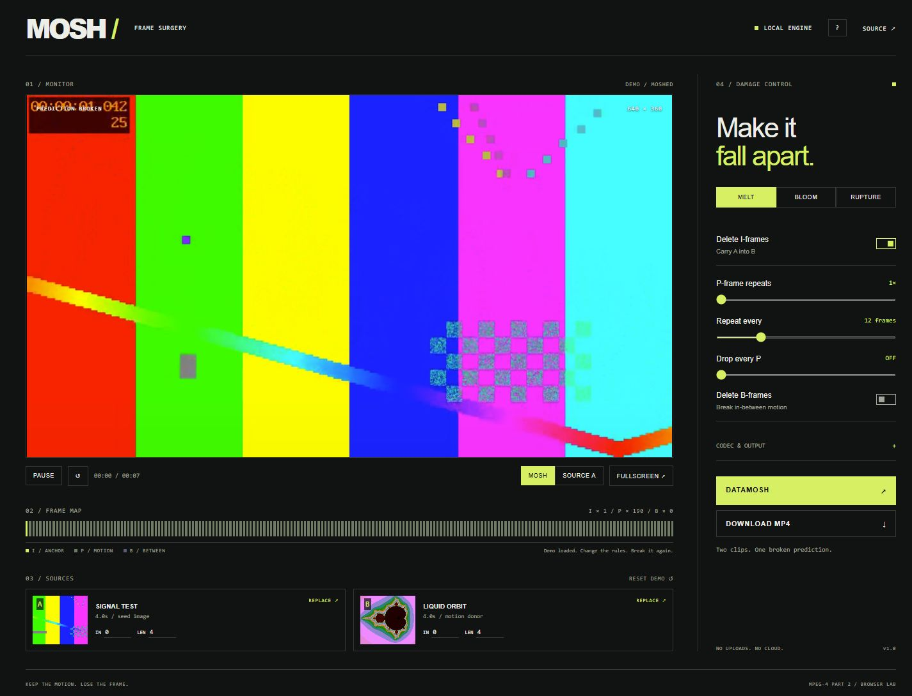
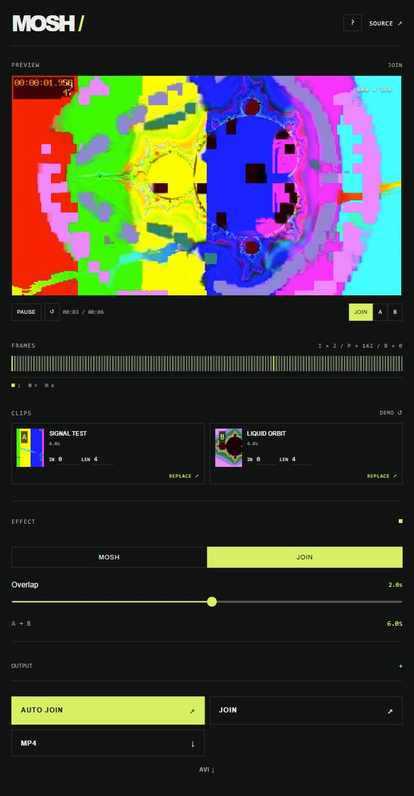
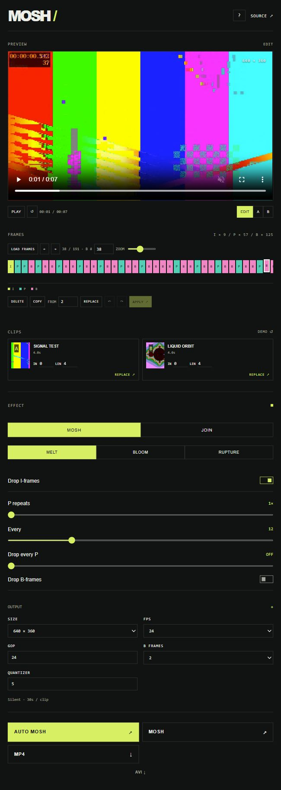

# MOSH / Frame surgery

**[Open the app →](https://mavroul1s.github.io/mosh/)**

A minimal, local video datamoshing desk. Actual MPEG-4 I/P/B-frame editing, a direct packet editor, two built-in clips, MOSH and JOIN modes, preview, and MP4 / raw AVI downloads. No account, uploads, server, or CDN.



## Open locally

Download **[index.html](https://github.com/mavroul1s/mosh/releases/latest/download/index.html)** and double-click it. All scripts, the single-thread WebAssembly codec, and demo videos/packets are embedded in this one file (~36 MB). Use current desktop Chrome or Edge for the best performance. You can also clone or download this repository and open `index.html` directly.

## Use

1. The demo opens with both videos loaded and a finished effect ready to play or download.
2. Replace A (the seed image) and B (the motion donor), or drop a video onto either source. Set IN and LEN in seconds.
3. Press **Auto Mosh** to choose balanced settings and render immediately. For manual control, pick **Melt**, **Bloom**, or **Rupture**. Adjust frame deletion, P-frame repeats, repeat interval, and B-frame deletion. Expand **Output** for size, FPS, GOP, B-frame encoding, and MPEG-4 quantizer.
4. Press **Mosh**. The frame map describes the resulting encoded stream. Download the preview as MP4, or download the damaged AVI for further editing.

Space toggles playback. The `?` button contains help. Changes apply on render; the prior output remains available until the next render succeeds.

New clips appear immediately in the main preview. Use **A / B** to inspect either source; browser-incompatible formats show a fallback while remaining available to the codec. Imports disable render until the file finishes loading. Uploaded clips use their full duration up to the 30-second limit by default.

## JOIN

Select **JOIN**, set **Overlap**, then press **Auto Join**. This creates one video that starts with A, carries A's image into B through a datamosh transition, then restores B and continues normally. The duration readout uses the selected trims:

**A + B − overlap**. Two 7-second clips with a 2-second overlap produce **12 seconds**. Zero overlap produces a straight 14-second join. Timing is rounded to the selected frame rate.

JOIN replaces the end of A with the transition into B: it retains A's prefix, preserves B's frame slots while suppressing incoming anchors during the overlap, and forces a fresh B keyframe when the overlap ends. It manages GOP/B-frame encoding and does not repeat or drop prediction frames, so those MOSH controls are hidden. Short clips automatically limit the overlap so both retain a frame. Output stays silent.



## Direct frame editing

The frame bar displays **every encoded packet**: I-frames in lime, P-frames in teal, and B-frames in pink. Scroll or zoom the bar; no frames are skipped. The pre-rendered demo is editable immediately.

- **Load Frames** encodes both selected clips without applying automatic mosh rules. Choose GOP and B Frames under Output before loading. Loading keeps both clips' anchors so you can remove them yourself.
- Click a frame, use the previous/next buttons or **Left / Right** arrows while the bar is focused. **Shift + Left / Right** jumps between I-frames. Home/End jumps to the ends. The number field jumps to a specific packet. Click I/P/B in the legend to jump to the next packet of that type.
- **Delete** (or the Delete/Backspace key) removes the selected packet. At least one packet must remain.
- **Copy** a donor packet, select the target, and press **Replace**. Alternatively enter a donor frame number in **From** and replace. The replacement uses the actual donor bytes and inherits its real I/P/B type; it does not relabel an incompatible bitstream.
- **Undo / Redo** restore pending edits. Ctrl/Cmd+Z, Shift+Ctrl/Cmd+Z, and Ctrl/Cmd+Y work while the bar is focused. Up to 100 pending operations are retained.
- **Apply** decodes the modified prediction chain and refreshes the MP4 preview/download. Pending changes use the previous preview for navigation; their corruption becomes visible after Apply. MP4 download is disabled while edits are pending. The AVI download always includes pending packet edits.

Applying or loading a new stream clears the pending undo history. Failed decoding preserves the previous MP4 and the pending edits so you can undo or restore an anchor. Some damaged packets do not produce a decoded image; the editor marks that rather than displaying a different frame. B-frame navigation uses the decoder's packet positions to account for display reordering.



## What the engine does

Both sources are trimmed and normalized to the same dimensions, frame rate, aspect ratio, and MPEG-4 Part 2 codec. They are encoded into video-only AVI containers. The parser walks RIFF chunks and classifies MPEG-4 VOPs from their `00 00 01 B6` start codes. It keeps the first anchor, optionally deletes later I-frames, drops selected P/B-frames, and duplicates selected P-frames from B. It rebuilds the AVI frame counts, `movi` chunks, and `idx1` index. FFmpeg then decodes the damaged prediction chain and renders an H.264 MP4 with new timestamps.

This is compressed-frame manipulation, rather than a canvas glitch simulation. Results depend on the footage and motion vectors; MPEG-4 corruption is deliberately unpredictable. Deleting I-frames is the main transition effect. Repeating P-frames blooms the accumulated motion. Disabling I-frame deletion retains the original anchors.

## Practical limits

- Exports are **silent**. Audio tracks are not included.
- Trims are 0.2–30 seconds per source; input files are capped at 150 MB each. The browser holds input and codec buffers in memory. Short clips and 640 × 360 are fastest.
- Common browser/FFmpeg-compatible formats are accepted, including MP4, WebM, MOV, MKV, and AVI. Unavailable codecs or damaged inputs produce an error without replacing the previous result.
- Aspect ratio is preserved with letterboxing to the selected 16:9 output. More repeated frames lengthen the output.
- Direct editing operates on the normalized MPEG-4 packets, rather than the source codec's original bitstream. Source video is re-encoded into a consistent MPEG-4 stream before surgery.
- Raw damaged AVI may display differently across decoders. The MP4 is the exact output shown by the preview.
- Rendering can take time on slower devices. Cancel terminates the worker; renders have a three-minute limit. Mobile memory limits may prevent larger renders.

## Build and verify

The project intentionally uses plain HTML, CSS, and JavaScript with no frontend build dependency.

```sh
python scripts/build.py
```

This embeds the source files, vendored codec, and demo assets into `index.html`. To regenerate the synthetic demo clips and their corrupted preview:

```sh
python -m pip install imageio-ffmpeg
python scripts/make-demos.py
python scripts/make-preview.py
python scripts/build.py
```

Node.js is needed for the AVI manipulation step. To run the browser integration checks:

```sh
python -m pip install playwright
python -m playwright install chromium
python tests/browser.py
```

JOIN frame-count and native decode checks:

```sh
node tests/join.cjs
python tests/join-native.py
node tests/frame-editor.cjs
python tests/frame-edit-native.py
```

The native check generates two 7-second inputs and verifies a decoded 12-second MP4 at 24 fps.

The tests open the standalone HTML through `file://`, exercise all three presets through the actual WASM codec, download MP4 and AVI, check cancellation, and check mobile layout. The two synthetic demo videos are generated specifically for this project with FFmpeg filters, without third-party footage.

## Credits and licenses

Application source: GPL-3.0-or-later. See [LICENSE](LICENSE). The bundled codec is `@ffmpeg/core-st` 0.11.1; see [THIRD_PARTY.md](THIRD_PARTY.md) for upstream source, build information, and license notices.
